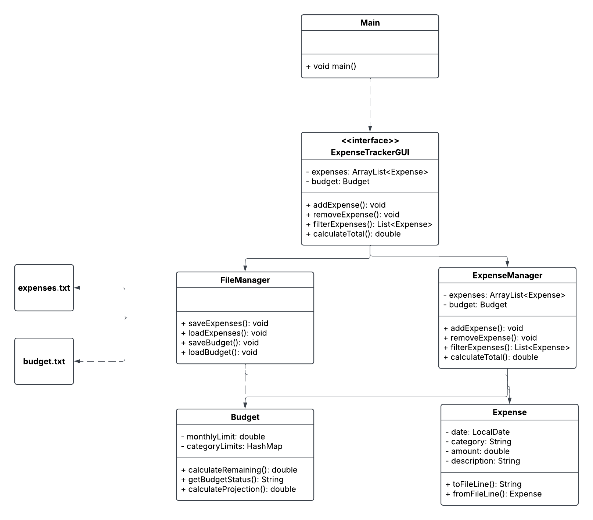

# Expense Tracker

A simple Java Swing application that helps to manager expenses and monthly budgets

## The Problem

College students run on a tight budget, and often don’t have a proper tracking system to see if they’re spending their money wisely. A bank app shows a balance and a list of past charges, but not by category against a plan. A running total of expenses also simply hides the pace/rate of what you spend in a month (e.g., : $400 spent by the 10th feels fine until you notice it adds up to a $1,200 month). Spreadsheets can answer this, but a student would have to spend a lot of time correcting it or accounting for additions often, valuable time that gets taken out of their day-to-day life.

## How It Works

A student can log each expense by category, and set a monthly budget alert with a limit for each category, and are able to see which categories are near or over their limit, and where the month is headed at the current rate at which they’re spending money. And everything would be saved to a text file to have a separate copy of expenses spending.

System Diagram:


Eisenhower Table can be found at:
docs/EisenhowerTable.png

## Tech Stack + Some details

- **Language:** Java (JDK 27)
- **GUI:** Swing (Java Inbuilt GUI) 
- **Libraries:** Only standard Java libraries (java.time, java.util, java.io); nothing extra to install
- **External tools:** N/A
- **Data:** Two text files for expenses and budgets
- **Tools:** VS Code, Git, and GitHub. Compile with javac

## Setup


```bash
git clone https://github.com/Vybhav26/ExpenseTracker
cd your-project
./install.sh   # or whatever
```

## Usage

1) Open the application.

2) Enter an expense with its date, category, amount, and description.

3) View and filter recorded expenses.

4) Set budget limits.

5) Monitor spending through the budget panel

## Roadmap

- Be able to filter categories 
- Recurring expenses, like monthly subscriptions should be something the user doesn’t have to worry about unless they explicitly change it.
- Potential ‘progress bar’ that gives an indicator of spending by category or time

## Author

Vybhav Parthan, https://github.com/Vybhav26